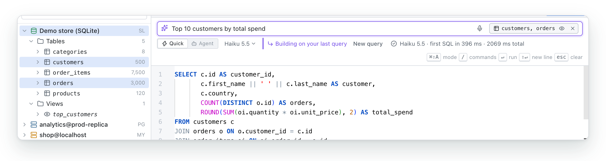
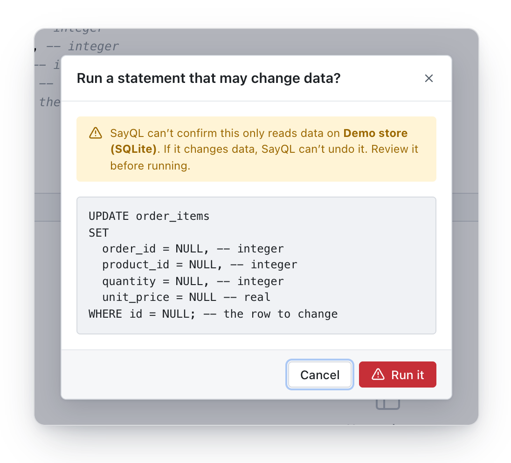
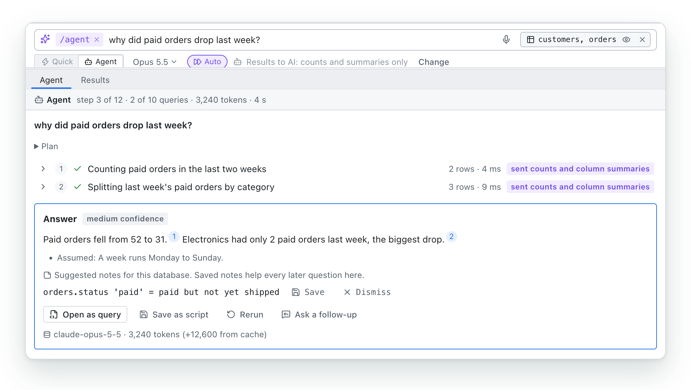

<div align="center">

<h1>
<picture>
  <source media="(prefers-color-scheme: dark)" srcset=".github/assets/wordmark-dark.svg">
  
</picture>
</h1>

### Ask your database anything. Break nothing.

The safe way for people and AI to query any database, even production.<br>
Any AI, read-only by default, and nothing changes unless you say so.

[](https://github.com/dithzz/sayql-releases/releases/latest)
[](https://github.com/dithzz/sayql/actions/workflows/ci.yml)
[](LICENSE)
[](https://github.com/dithzz/sayql-releases/releases/latest)

[**Download**](https://github.com/dithzz/sayql-releases/releases/latest) · [Docs](https://sayql.dev/docs/) · [Website](https://sayql.dev) · [Discussions](https://github.com/dithzz/sayql/discussions)

<br>

<picture>
  <source media="(prefers-color-scheme: dark)" srcset=".github/assets/hero-dark.png">
  
</picture>

</div>

## Why SayQL

**SayQL is the safe way for people and AI to query any database, even production.** It's for analysts, product
managers, support and operations teams, developers who only touch the database now and then, and the AI apps
they work with. Asking an engineer takes time; general chatbots don't know your schema and can't run anything
safely; and an AI agent with a database password can do anything. SayQL keeps the AI on your rules.

- **Safe on production, by design.** Queries run read-only, and the database itself enforces it. Anything that
  could change data stops and shows you the exact statement first.
- **It knows your schema.** Tables, columns and relationships across every database you connect, so the SQL
  uses your real names and joins, not guesses.
- **Faster than writing it yourself.** The right SQL in seconds, streaming in while you type. Simple
  requests are answered instantly on your machine, follow-ups edit the query you have ("only Canada",
  "sort by date"), and failed queries fix themselves once.
- **Answers to the harder questions.** Switch the Ask box from Quick to Agent and ask "why did signups drop?"
  or "who owns this tenant?": the agent investigates in read-only steps and answers with the queries behind
  every sentence. Off until you turn it on per connection, with you in control of what the AI may see.
- **Any AI, any database.** Use Claude, OpenAI, Gemini or any OpenAI-compatible API with your own key, a local
  model so nothing leaves your computer, or SayQL AI credits, on PostgreSQL, MySQL, SQLite or SQL Server. Switch
  models right in the Ask box. The Ask box never sends table rows to the AI.
- **AI apps on a leash.** Claude, Cursor and other MCP apps can query through SayQL, read-only, with your
  never-send columns kept private, or hand you a query to review before anything runs.
- **Rules and a record for teams.** [SayQL for teams](https://sayql.dev/#teams) is a server you run: shared
  connections without passwords on laptops, rules the AI can't cross, and a record of every query, from people
  and from agent mode. Your data never reaches us.
- **Say it instead.** Click the mic and say your question. Speech is turned into text on your computer, and
  the audio never leaves it.
- **Everything in one place.** Browse your tables, keep tabs open and save the queries you reuse. You see every
  query, so you learn SQL as you go.

## Features

<table>
<tr>
<td width="50%" valign="top">

### It knows your schema

Ask in plain English, then refine it the same way: "only Canada", "sort by date". SayQL writes against your
real tables, columns and relationships. Click tables in the navigator to point it at the right place, and if
the database rejects a query, SayQL fixes it automatically.

<picture>
  <source media="(prefers-color-scheme: dark)" srcset=".github/assets/feature-ask-dark.png">
  
</picture>

</td>
<td width="50%" valign="top">

### Safe on production

Every query runs read-only, and the database itself enforces it. Anything that could change data stops and
shows you the exact statement first, so nothing changes by accident.

<picture>
  <source media="(prefers-color-scheme: dark)" srcset=".github/assets/feature-write-confirm-dark.png">
  
</picture>

</td>
</tr>
<tr>
<td colspan="2" valign="top">

### Investigate with agent mode

Switch the Ask box to Agent (or type `/agent`) and ask a question that needs looking around first ("why did signups drop last week?", "who owns this
tenant?"). The agent shows its plan, works through it in read-only steps, checks its joins, asks you when a
question has two meanings, and answers with every sentence linked to the query behind it. A number it can't
find in any result is marked "not verified". It never runs writes: a change comes back as SQL for you to review. Auto
mode lets it run without stopping for the plan or each send.
It's off on every connection until you turn it on, and you choose what it may see of results: nothing, counts
and summaries, or up to 20 rows with personal data masked. What it learns can be saved as database notes,
which help the Ask box, the agent and MCP next time.

<picture>
  <source media="(prefers-color-scheme: dark)" srcset=".github/assets/feature-agent-dark.png">
  
</picture>

### Your AI, your data

Use Claude, OpenAI, Gemini or any OpenAI-compatible API with your own key, or run a model on your own computer
with Ollama or LM Studio, so your questions never leave it. The Ask box never sends table rows to the AI; agent
mode can, only on connections where you turn it on. A setup guide
gets you to your first answer quickly.

<picture>
  <source media="(prefers-color-scheme: dark)" srcset=".github/assets/feature-setup-ai-dark.png">
  
</picture>

</td>
</tr>
</table>

## Works with

| Databases | AI providers |
| --- | --- |
| PostgreSQL | Anthropic Claude (recommended) |
| MySQL / MariaDB | OpenAI · Google Gemini · OpenRouter |
| SQLite | Mistral · Groq · DeepSeek |
| Microsoft SQL Server | Ollama · LM Studio (on your computer) |
| Azure SQL | Any OpenAI-compatible API (Azure, vLLM, LiteLLM, …) |

For servers, the navigator lists every database your login can open. A demo SQLite store is
built in, so you can try everything without connecting anything.

## Get started

1. **Download** the installer for your computer from the
   [latest release](https://github.com/dithzz/sayql-releases/releases/latest): `.dmg` for macOS (`aarch64`
   for Apple silicon, `x64` for Intel), `-setup.exe` or `.msi` for Windows, `.AppImage`, `.deb` or `.rpm`
   for Linux.
2. **Open it.** Early-access builds aren't code-signed yet, so confirm the first launch once: on macOS,
   System Settings → Privacy & Security → **Open Anyway**; on Windows, **More info → Run anyway**.
3. **Follow the setup guide:** pick your AI, use the demo database or connect your own, and ask your first
   question.

The [docs](https://sayql.dev/docs/) cover every step, each AI provider and database, and
[troubleshooting](https://sayql.dev/docs/troubleshooting/). SayQL updates itself: when a new version is
out, **Update to x.y.z** appears in the status bar, and every update is signature-checked.

## Your data

SayQL has no account, no server of its own and no telemetry. It connects straight from your machine to your
database, and sends data only to services you configure:

| When | What's sent | Where |
| --- | --- | --- |
| You ask in plain English | Your question, the schema (table and column names, types, keys), and the current SQL for follow-ups | Your AI provider |
| A query fails and SayQL fixes it | The query and the database's error message | Your AI provider |
| You use agent mode on a connection where you turned it on | The agent's queries and, per your setting, row counts, column summaries, or up to 20 masked rows per query | Your AI provider |
| An AI app uses SayQL through MCP | The schemas, database notes and query results it asks for (never the values of never-send columns) | That AI app (for example Claude or Cursor) |
| You run a query | Your SQL | Your database |
| SayQL starts | The app version and your operating system, to check for updates | GitHub (dithzz/sayql-releases) |
| You first use voice input | A one-time download of the speech model (no audio) | Hugging Face |

**Rows in your tables are never sent to an AI provider by the Ask box.** Agent mode can send them, only on
connections where you turn it on (off by default), with likely personal data masked. Database passwords and API keys are
kept in your OS keychain (macOS Keychain, Windows Credential Manager or Secret Service), never in files. With
Ollama or LM Studio, nothing leaves your computer. Voice input is transcribed on your computer and audio is
never sent anywhere. Details: [PRIVACY.md](PRIVACY.md).

## How it works

```
 You type ──▶ instant local answer? ──yes──▶ SQL
                     │ no
                     ▼
          cached answer? ──yes──▶ SQL
                     │ no
                     ▼
   AI provider (after 250 ms idle) ──streams──▶ editor ──Run──▶ read-only check ──▶ your database
   schema in a cached prompt prefix                                  │
                                                             writes stop for confirmation
```

- The schema is read once per database and cached. On large schemas, SayQL sends the tables relevant to the
  question; when you pick tables, it sends those plus the tables they connect to.
- The schema sits in a fixed prompt prefix (prompt caching on Claude, automatic prefix caching where the
  provider has it), so each keystroke only sends your question fresh. Every new keystroke cancels the
  request before it.
- A statement counts as read-only only if it starts with a reading keyword and contains no write keyword
  outside strings and comments. Reads then run inside `BEGIN READ ONLY` / `START TRANSACTION READ ONLY`, or on a
  read-only SQLite connection, so the database rejects writes even if a check were wrong. SQL Server has no
  read-only mode, so reads run in a transaction that's always rolled back. For production SQL Servers, use a
  login with only `db_datareader`.

## Use SayQL from AI apps (MCP)

SayQL includes an MCP server, `sayql-mcp`, that lets Claude Code, Claude Desktop, Cursor and other MCP apps
use the connections you saved in SayQL: `list_connections`, `list_databases`, `describe_schema` and
`run_query`. It's read-only, with the same checks as the app. Results come in pages (100 rows by default,
1,000 at most) and are sent to that app. Passwords never are.

- `list_scripts` lists your saved scripts, with their SQL.
- `export_csv` saves a read-only query's rows (up to 100,000) to a new CSV in your Downloads folder. The rows
  aren't sent to the app, only the file path.

Three more tools hand work to you in SayQL instead of doing it:

- `add_connection` opens SayQL's New connection dialog with the details filled in. You type the password in
  SayQL, test and save. The tool refuses passwords and other secrets.
- `open_query` opens SQL in a new SayQL tab without running it. You review it and click Run; SayQL asks before
  anything that changes data, and the results stay in SayQL.
- `open_script` opens one of your saved scripts, unrun.

`describe_schema` includes the database notes you saved, so the app knows what codes mean and how tables
relate. Columns you marked **never send** in a connection's agent settings stay private over MCP too: queries
naming them are refused and their values are withheld. The AI app writes the SQL itself, so MCP never uses
your SayQL AI key; SQL it opens in SayQL isn't fixed automatically by SayQL's AI either.

Passwords and writes never go through MCP.

`sayql-mcp` ships inside the app: **Settings → AI apps (MCP)** shows the path and the setup for each AI app.

> **Note:** on Linux, use the `.deb` or `.rpm` for MCP: the AppImage opens from a new folder each time, so the
> path would change.

## Build from source

You need Rust (stable), Node.js LTS, pnpm 10 and the
[Tauri prerequisites](https://v2.tauri.app/start/prerequisites/) for your platform.

```bash
git clone https://github.com/dithzz/sayql.git
cd sayql
pnpm install
pnpm tauri dev      # run the app
pnpm test           # frontend and backend tests
pnpm tauri build    # installers for your platform
```

To work on the UI without the Rust backend, run `pnpm dev` and open http://localhost:1420: a mock backend
serves demo data, so you need no database or AI key.

**Stack:** [Tauri 2](https://tauri.app) (Rust) with React, TypeScript and the
[Monaco](https://microsoft.github.io/monaco-editor/) editor. Database drivers are
[`sqlx`](https://github.com/launchbadge/sqlx) and [`tiberius`](https://github.com/prisma/tiberius) (SQL
Server). Voice input uses [whisper.cpp](https://github.com/ggml-org/whisper.cpp) through
[`whisper-rs`](https://crates.io/crates/whisper-rs), and [`cpal`](https://crates.io/crates/cpal) for the
microphone (on Linux, install `libasound2-dev` to build). [docs/ARCHITECTURE.md](docs/ARCHITECTURE.md) explains the structure and conventions, and
[docs/RELEASING.md](docs/RELEASING.md) covers signing, updates and publishing.

## Roadmap

- **Signed builds** for macOS and Windows, removing the first-launch confirmation.

Ideas and votes are welcome in [Discussions](https://github.com/dithzz/sayql/discussions).

## How SayQL is funded

SayQL is made by one person. The app is free and will stay that way; teams that need control can pay for
[SayQL for teams](https://sayql.dev/#teams), a server they run themselves (free for 30 days: run
`curl -fsSL https://sayql.dev/install | sh` on a machine with Docker; see the
[setup guide](https://sayql.dev/docs/teams/#set-up-a-team-server)). These promises hold either way:

1. **Single-user stays free.** Everything one person needs to ask, run, fix and export works in this app,
   forever, including at work and including agent mode.
2. **No take-backs.** A feature that shipped free never moves to a paid plan.
3. **Paid means multi-user and governance.** Shared connections, admin-set rules, audit logs, SSO and
   approvals: things that only matter when a company manages many people or AI agents.
4. **Your data never reaches SayQL.** The team server runs on your own network.
5. **No ads, no data sales, no hidden telemetry.** Licence keys work offline; nothing phones home.
6. **The app stays Apache-2.0.** Paid code lives in a separate server, not in a closed fork of the app.
7. **Public pricing.** Prices will be on the website.

## Community

- **Questions, ideas and feedback:** [Discussions](https://github.com/dithzz/sayql/discussions)
- **Bugs and feature requests:** [Issues](https://github.com/dithzz/sayql/issues/new/choose)
- **Want to help?** Start with a [good first issue](https://github.com/dithzz/sayql/issues?q=is%3Aissue+is%3Aopen+label%3A%22good+first+issue%22)
  or one marked [help wanted](https://github.com/dithzz/sayql/issues?q=is%3Aissue+is%3Aopen+label%3A%22help+wanted%22).
- **What's new:** [CHANGELOG.md](CHANGELOG.md) and [releases](https://github.com/dithzz/sayql-releases/releases)

If SayQL saves you time, a ⭐ helps other people find it.

## Contributing

Contributions are welcome: bug reports, ideas, docs and code. [CONTRIBUTING.md](CONTRIBUTING.md) covers
setup for each platform, the integration tests, conventions and how to open a pull request. Please follow the
[Code of Conduct](CODE_OF_CONDUCT.md), and report security problems privately as described in
[SECURITY.md](SECURITY.md).

## License

SayQL is open source under the [Apache License 2.0](LICENSE). The SayQL name and logo aren't covered by the
license, so forks need their own (see [NOTICE](NOTICE)). Open-source components are credited in
`THIRD-PARTY-NOTICES.txt` (regenerate with `python3 scripts/third_party_notices.py`), which ships with the app
along with the license, notices and [privacy notice](PRIVACY.md).

<div align="center">
<br>
<sub>Built with Tauri, Rust and React · <a href="https://sayql.dev">sayql.dev</a></sub>
</div>
