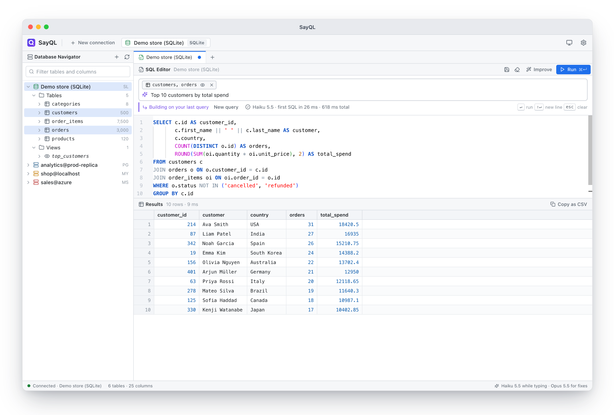
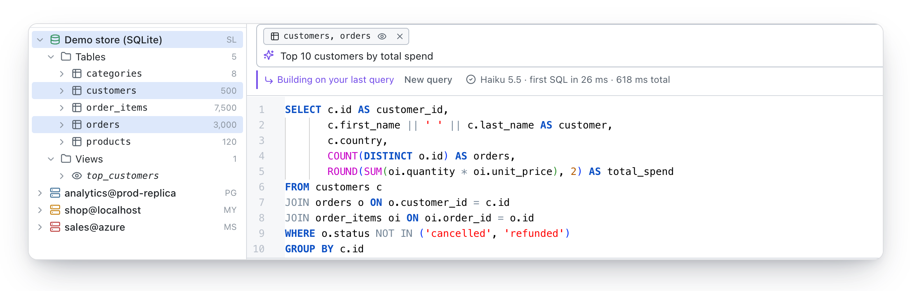
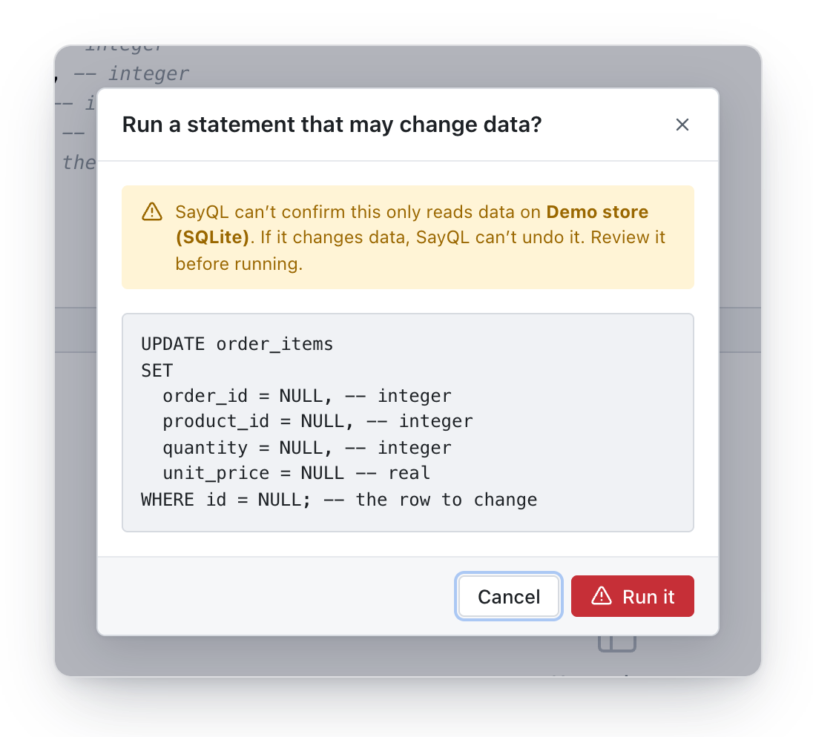
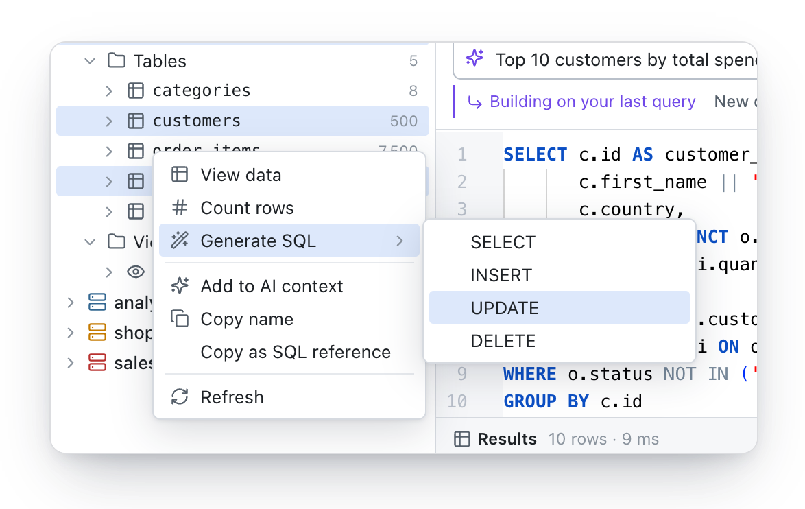
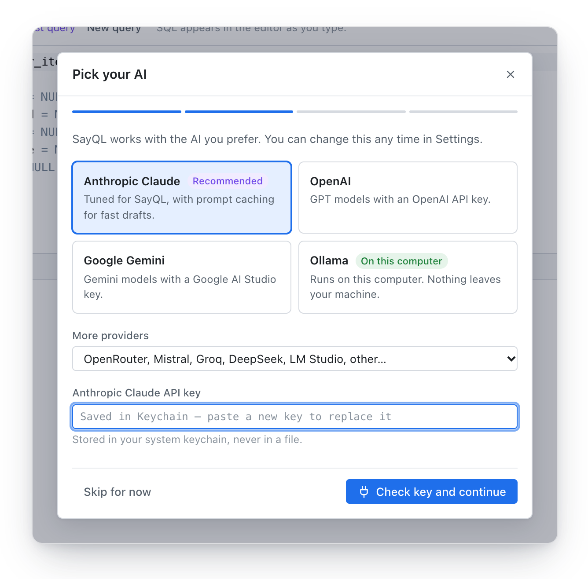

<div align="center">


# SayQL

**Say what you need. Get the SQL.**

An AI-first desktop database client. Type plain English, watch the SQL appear as you type,<br>
and run it read-only by default, on PostgreSQL, MySQL, SQLite, SQL Server and Azure SQL, with the AI you choose.

[](https://github.com/dithzz/sayql-releases/releases/latest)
[](https://github.com/dithzz/sayql/actions/workflows/ci.yml)
[](LICENSE)
[](https://github.com/dithzz/sayql-releases/releases/latest)

[**Download**](https://github.com/dithzz/sayql-releases/releases/latest) · [Docs](https://sayql.vercel.app/docs/) · [Website](https://sayql.vercel.app) · [Discussions](https://github.com/dithzz/sayql-releases/discussions)

<br>

<picture>
  <source media="(prefers-color-scheme: dark)" srcset=".github/assets/hero-dark.png">
  
</picture>

</div>

## Why SayQL

Most people who work with data know what they want to ask, but not always how to write it in SQL. Chatbots
can write a query, but they don't know your schema, can't run anything, and copy-pasting between windows gets
old fast. SayQL puts the AI inside a real database client:

- **SQL as you type.** A fast model drafts the query in about a second while you're still typing, and simple
  requests like "show customers" are answered instantly on your machine with no AI call at all.
- **Follow-ups that edit, not restart.** "Only Canada", "remove the middle name", "sort by date" change the
  query you already have.
- **Safe on production.** Queries run read-only, enforced by the database itself. Anything that could change
  data stops and shows you the statement first.
- **Your AI, your data.** Use Claude, OpenAI, Gemini or any OpenAI-compatible API with your own key, or a
  local model so nothing leaves your computer. Table rows are never sent to the AI.
- **A proper workbench.** Navigator, tabs, saved scripts, a Monaco editor and a fast results grid, in light
  and dark mode.

## Features

<table>
<tr>
<td width="50%" valign="top">

### Point it at the right tables

Click, ⌘-click or ⇧-click tables in the navigator to give the AI context. They show as a pill in the Ask box, which you can hide without losing the selection. Follow-ups edit the query you have, and the status line shows the model and how fast it answered.

<picture>
  <source media="(prefers-color-scheme: dark)" srcset=".github/assets/ask-dark.png">
  
</picture>

</td>
<td width="50%" valign="top">

### Read-only by default

SayQL checks every statement, and reads run in a read-only transaction or connection, so the database itself refuses writes (SQL Server rolls them back). <code>INSERT</code>, <code>UPDATE</code>, <code>DELETE</code> and DDL always stop for review.

<picture>
  <source media="(prefers-color-scheme: dark)" srcset=".github/assets/write-confirm-dark.png">
  
</picture>

</td>
</tr>
<tr>
<td width="50%" valign="top">

### Right-click everything

View data, count rows, generate <code>SELECT</code> / <code>INSERT</code> / <code>UPDATE</code> / <code>DELETE</code> templates, add tables to the AI's context and more, like DBeaver. Generated writes match no rows until you fill them in.

<picture>
  <source media="(prefers-color-scheme: dark)" srcset=".github/assets/context-menu-dark.png">
  
</picture>

</td>
<td width="50%" valign="top">

### Any AI, including local models

A first-run guide sets up your provider and checks the key before saving. Claude is tuned with prompt caching; Ollama and LM Studio run entirely on your machine. When the database rejects a query SayQL wrote, it fixes it once automatically, and <b>Improve</b> reviews any query on request.

<picture>
  <source media="(prefers-color-scheme: dark)" srcset=".github/assets/setup-ai-dark.png">
  
</picture>

</td>
</tr>
</table>

## Works with

| Databases | AI providers |
| --- | --- |
| PostgreSQL | Anthropic Claude (recommended) |
| MySQL / MariaDB | OpenAI · Google Gemini · OpenRouter |
| SQLite | Mistral · Groq · DeepSeek |
| Microsoft SQL Server | Ollama · LM Studio (on your computer) |
| Azure SQL | Any OpenAI-compatible API (Azure, vLLM, LiteLLM, …) |

For servers, the navigator lists every database your login can open, like DBeaver. A demo SQLite store is
built in, so you can try everything without connecting anything.

## Get started

1. **Download** the installer for your computer from the
   [latest release](https://github.com/dithzz/sayql-releases/releases/latest): `.dmg` for macOS (`aarch64`
   for Apple silicon, `x64` for Intel), `-setup.exe` or `.msi` for Windows, `.AppImage`, `.deb` or `.rpm`
   for Linux.
2. **Open it.** Early-access builds aren't code-signed yet, so confirm the first launch once: on macOS,
   System Settings → Privacy & Security → **Open Anyway**; on Windows, **More info → Run anyway**.
3. **Follow the setup guide:** pick your AI, use the demo database or connect your own, and ask your first
   question.

The [docs](https://sayql.vercel.app/docs/) cover every step, each AI provider and database, and
[troubleshooting](https://sayql.vercel.app/docs/troubleshooting/). SayQL updates itself: when a new version is
out, **Update to x.y.z** appears in the status bar, and every update is signature-checked.

## Your data

SayQL has no account, no server of its own and no telemetry. It connects straight from your machine to your
database, and sends data only to services you configure:

| When | What's sent | Where |
| --- | --- | --- |
| You ask in plain English | Your question and the schema (table and column names, types, keys) | Your AI provider |
| A query fails and SayQL fixes it | The query and the database's error message | Your AI provider |
| You run a query | Your SQL | Your database |

**Rows in your tables are never sent to an AI provider by the Ask box.** Database passwords and API keys are
kept in your OS keychain (macOS Keychain, Windows Credential Manager or Secret Service), never in files. With
Ollama or LM Studio, nothing leaves your computer. Details: [PRIVACY.md](PRIVACY.md).

## How it works

```
 You type ──▶ instant local answer? ──yes──▶ SQL
                     │ no
                     ▼
          cached answer? ──yes──▶ SQL
                     │ no
                     ▼
   AI provider (after 250 ms idle) ──streams──▶ editor ──Run──▶ read-only check ──▶ your database
   schema in a cached prompt prefix                                  │
                                                             writes stop for confirmation
```

- The schema is read once per database and cached. On large schemas, SayQL sends the tables relevant to the
  question; when you pick tables, it sends those plus the tables they connect to.
- The schema sits in a fixed prompt prefix (prompt caching on Claude, automatic prefix caching where the
  provider has it), so each keystroke only sends your question fresh. Every new keystroke cancels the
  request before it.
- A statement counts as read-only only if it starts with a reading keyword and contains no write keyword
  outside strings and comments. Reads then run inside `BEGIN READ ONLY` / `START TRANSACTION READ ONLY`, or on a
  read-only SQLite connection, so the database rejects writes even if a check were wrong. SQL Server has no
  read-only mode, so reads run in a transaction that's always rolled back. For production SQL Servers, use a
  login with only `db_datareader`.

## Use SayQL from AI apps (MCP)

SayQL includes an MCP server, `sayql-mcp`, that lets Claude Code, Claude Desktop, Cursor and other MCP apps
use the connections you saved in SayQL: `list_connections`, `list_databases`, `describe_schema` and
`run_query`. It's read-only, with the same checks as the app. Results are capped (100 rows by default, 1,000
at most) and are sent to that app. Passwords never are.

> **Note:** the MCP server isn't bundled with the v0.1.0 downloads yet. It's coming in the next release.
> Until then, build it from source (`cargo build --bin sayql-mcp`); see [CONTRIBUTING.md](CONTRIBUTING.md).

## Build from source

You need Rust (stable), Node.js LTS, pnpm 10 and the
[Tauri prerequisites](https://v2.tauri.app/start/prerequisites/) for your platform.

```bash
git clone https://github.com/dithzz/sayql.git
cd sayql
pnpm install
pnpm tauri dev      # run the app
pnpm test           # frontend and backend tests
pnpm tauri build    # installers for your platform
```

To work on the UI without the Rust backend, run `pnpm dev` and open http://localhost:1420: a mock backend
serves demo data, so you need no database or AI key.

**Stack:** [Tauri 2](https://tauri.app) (Rust) with React, TypeScript and the
[Monaco](https://microsoft.github.io/monaco-editor/) editor. Database drivers are
[`sqlx`](https://github.com/launchbadge/sqlx) and [`tiberius`](https://github.com/prisma/tiberius) (SQL
Server). [docs/ARCHITECTURE.md](docs/ARCHITECTURE.md) explains the structure and conventions, and
[docs/RELEASING.md](docs/RELEASING.md) covers signing, updates and publishing.

## Roadmap

- **MCP server in the downloads**, so AI apps can use SayQL without building it.
- **The SayQL agent:** a side panel that works through whole questions ("why do some accounts have no
  invoices?") with read-only queries, and answers with every claim linked to the query behind it.
- **Signed builds** for macOS and Windows, removing the first-launch confirmation.

Ideas and votes are welcome in [Discussions](https://github.com/dithzz/sayql-releases/discussions).

## Contributing

Contributions are welcome: bug reports, ideas, docs and code. [CONTRIBUTING.md](CONTRIBUTING.md) covers
setup for each platform, the integration tests, conventions and how to open a pull request. Please follow the
[Code of Conduct](CODE_OF_CONDUCT.md), and report security problems privately as described in
[SECURITY.md](SECURITY.md).

## License

SayQL is open source under the [Apache License 2.0](LICENSE). The SayQL name and logo aren't covered by the
license, so forks need their own (see [NOTICE](NOTICE)). Open-source components are credited in
`THIRD-PARTY-NOTICES.txt` (regenerate with `python3 scripts/third_party_notices.py`), which ships with the app
along with the license, notices and [privacy notice](PRIVACY.md).

<div align="center">
<br>
<sub>Built with Tauri, Rust and React · <a href="https://sayql.vercel.app">sayql.vercel.app</a></sub>
</div>
